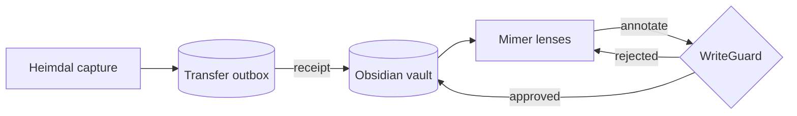
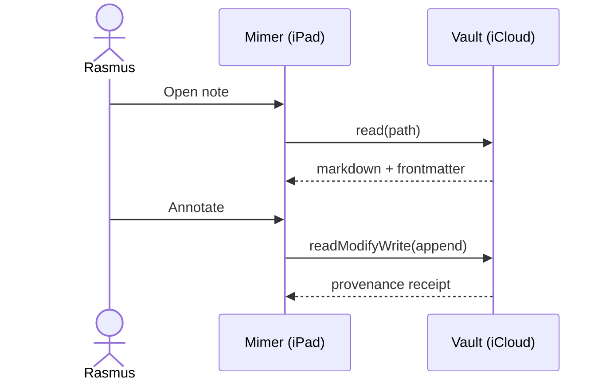
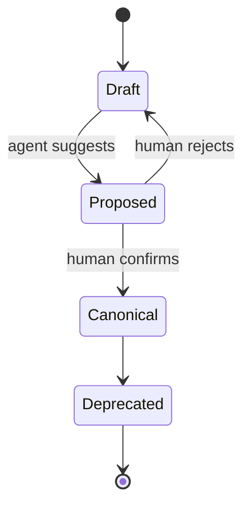
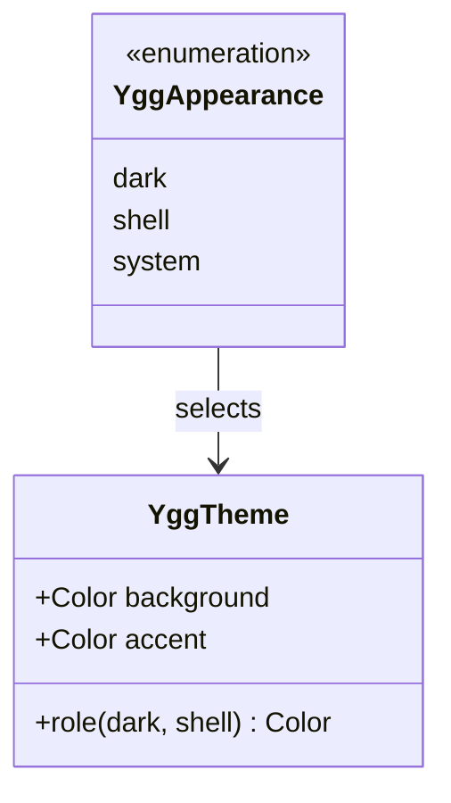
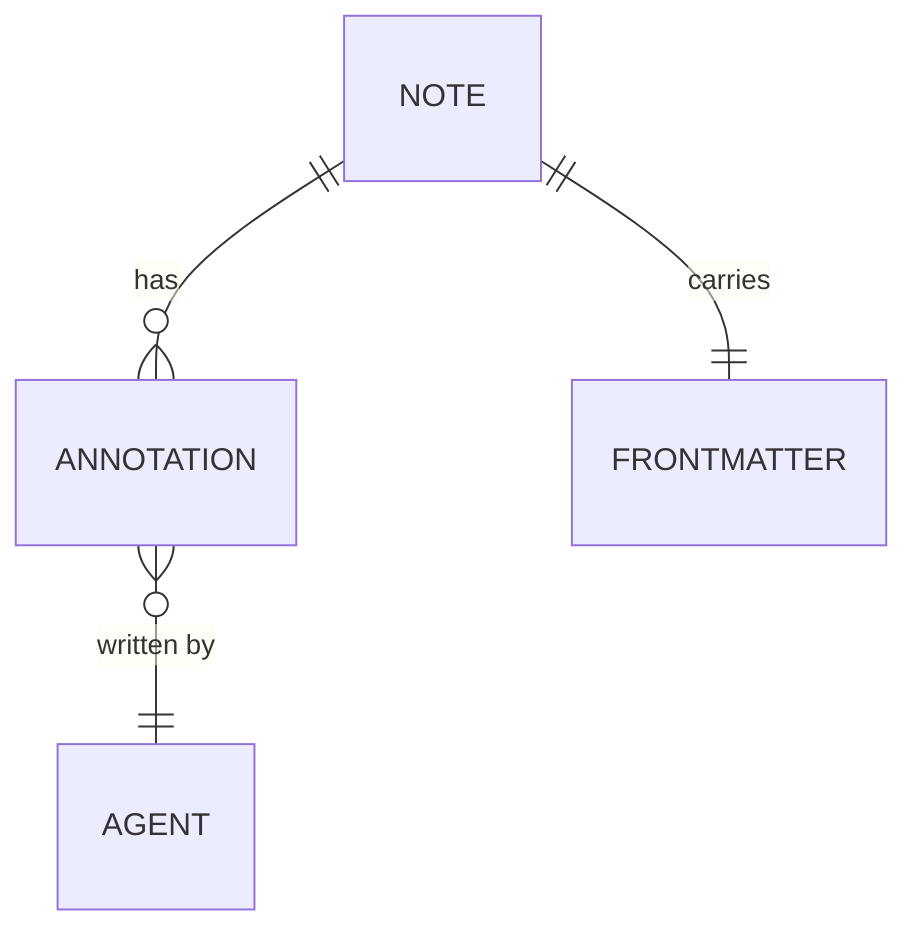
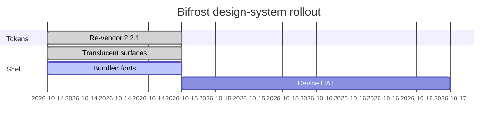
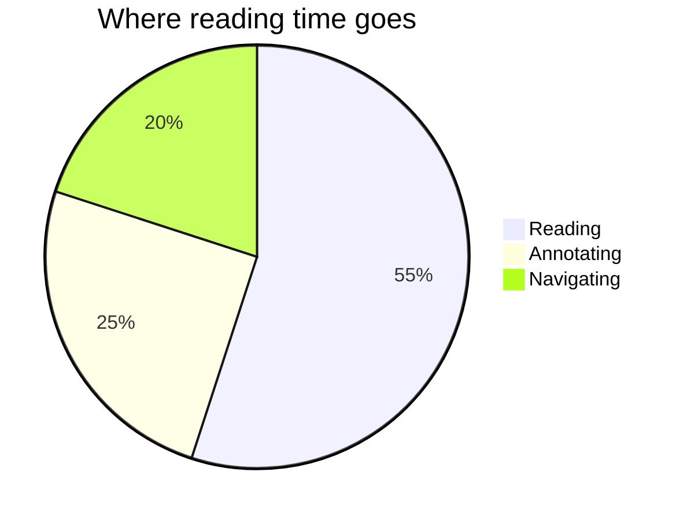
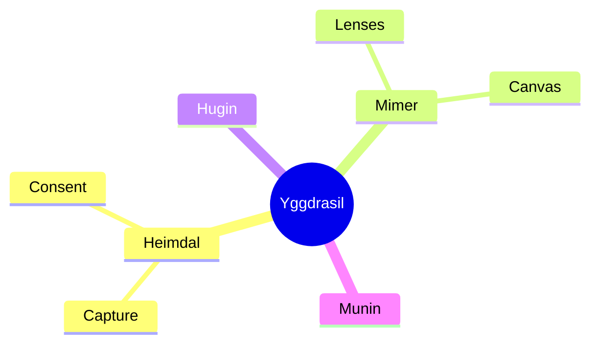

# Markdown och Mermaid – testnot

A render test for Mimer (Bifrost) and Obsidian. Every section below exercises one feature, so it is easy to see what renders, what degrades, and what breaks. Swedish characters for font coverage: **å ä ö Å Ä Ö**, and typographic marks: “quotes”, ‘single’, en–dash, em—dash, ellipsis…

## 1. Headings

### Heading level 3
#### Heading level 4
##### Heading level 5
###### Heading level 6

## 2. Inline formatting

Plain text with **bold**, *italic*, ***bold italic***, ~~strikethrough~~, ==highlight==, `inline code`, and a [regular link](https://obsidian.md). Obsidian wikilinks: [[fixture]], [[source|aliased link]], and a heading link [[#4. Lists]]. Tags: #uat #bifrost/rendering. A footnote reference[^1] and an inline footnote.^[Inline footnotes are an Obsidian extension.]

Line one ends with two spaces  
so this is a hard line break inside the same paragraph.

## 3. Block quotes and callouts

> A plain block quote.
> > A nested quote inside it.

> [!note] Note callout
> Callouts are Obsidian-flavoured block quotes with a type.

> [!warning] Warning callout
> Should render with the amber / staged meaning in Yggdrasil.

> [!tip]- Collapsed tip (foldable)
> Hidden until expanded in Obsidian.

## 4. Lists

- Unordered item
- Item with **formatting** and `code`
  - Nested item
    - Third level
- Back to level one

1. Ordered item
2. Second item
   1. Nested ordered
   2. Another
3. Third item

- [ ] Open task
- [x] Completed task
- [ ] Task with a date 📅 2026-10-20

## 5. Table

| Theme | Surface | Ink contrast | Notes |
|:------|:-------:|-------------:|-------|
| Yggdrasil Dark | `#070B12` | 15.81 | Default |
| Yggdrasil Light “Shell” | porcelain | 4.63–8.83 | Ghost in the Shell |
| System | follows device | — | Shell in light mode |

## 6. Code

```swift
enum YggAppearance: String, CaseIterable {
    case dark, shell, system
    var colorScheme: ColorScheme? {
        switch self {
        case .dark: .dark
        case .shell: .light
        case .system: nil
        }
    }
}
```

```python
def resolve(theme: str | None) -> str:
    return theme if theme in {"dark", "light", "system"} else "dark"
```

```json
{ "theme": "shell", "density": "comfortable" }
```

## 7. Math

Inline math: $E = mc^2$. Block math:

$$
\sum_{i=1}^{n} i = \frac{n(n+1)}{2}
$$

## 8. Horizontal rule

---

## 9. Mermaid diagrams

### 9.1 Flowchart



### 9.2 Sequence diagram



### 9.3 State diagram



### 9.4 Class diagram



### 9.5 Entity relationship



### 9.6 Gantt



### 9.7 Pie chart



### 9.8 Mindmap



## 10. Embeds and HTML

![[fixture]]

<details>
<summary>Raw HTML details block</summary>

Content inside an HTML `<details>` element.

</details>

## 11. Long content

A deliberately long paragraph to test line length, wrapping and reading comfort on the porcelain reading surface. Lorem ipsum is avoided on purpose: this sentence keeps going so that the line wraps several times across the column, and the rhythm of the body face (Space Grotesk) can be judged next to the headings and the monospaced code blocks above it.

[^1]: A standard Markdown footnote, rendered at the end of the note.
